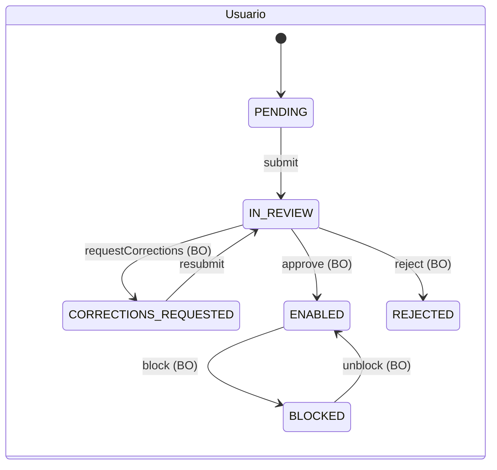
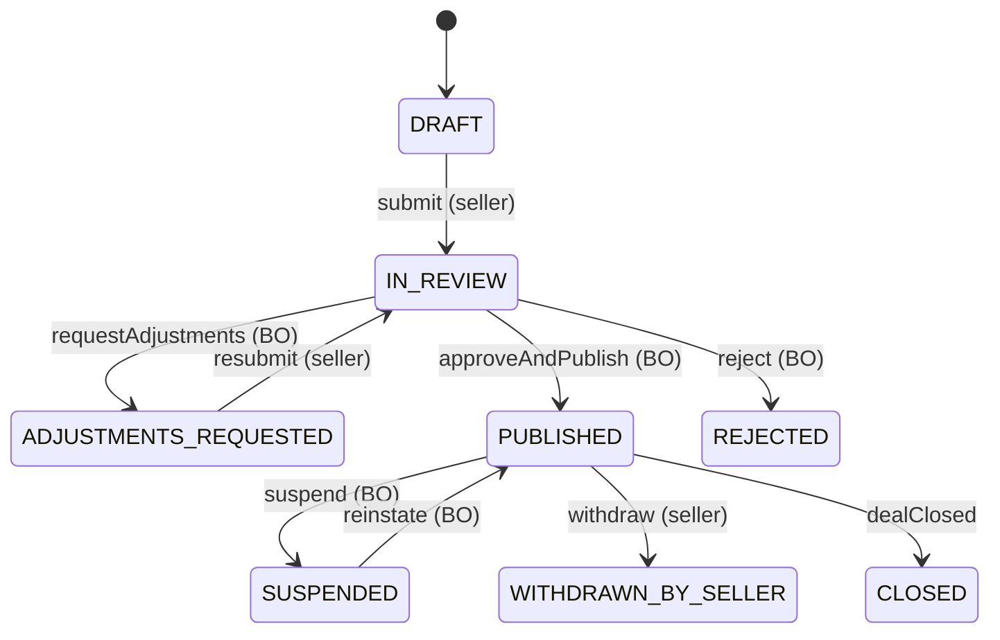
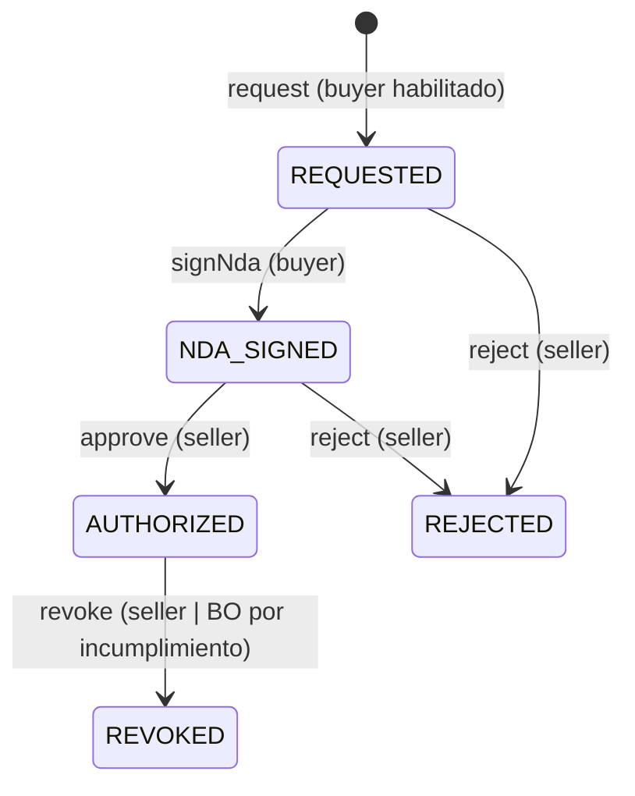
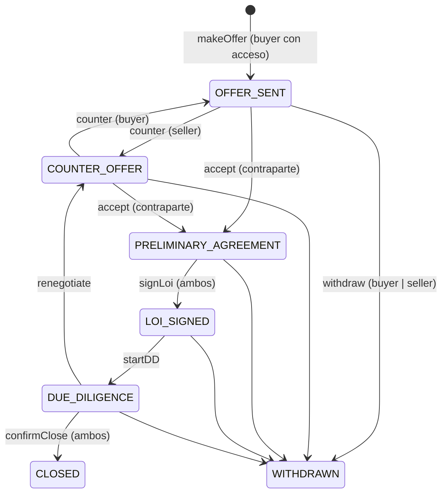

# Arquitectura de La Dorada

Documento de referencia de la arquitectura. Las decisiones de fondo están en `docs/adr/`. Las secciones de este archivo copian sin cambios la especificación `docs/superpowers/specs/2026-10-26-la-dorada-design.md` (§3.1, §5 y §7).

## 1. Capas y flujo de mutación

**Monolito Next.js modular** (decisión del usuario; ADR-001).

- Next.js 15 (App Router) + TypeScript estricto + Tailwind CSS + shadcn/ui; pnpm.
- PostgreSQL 16 + Prisma (migraciones versionadas).
- MinIO (S3-compatible) con bucket privado; descargas solo por URL prefirmada.
- Docker Compose: `app`, `db`, `minio`, `mailpit`.
- Vitest (unidad/integración), Playwright (E2E), GitHub Actions (lint, typecheck, test, build).

```
src/domain/     Puro (sin I/O). Máquinas de estado, políticas can*(), valoración y score, Money/COP, errores de dominio.
src/server/     I/O. auth/, db/ (Prisma), repos/, services/, storage/, realtime/, audit/, adapters/{kyc,esign,video,mail}/
src/app/        Rutas: (public) landing/teaser público, (auth) login/registro, (buyer), (seller), (backoffice), api/
src/components/ ui/ (shadcn) y ld/ (componentes de marca: OpportunityCard, KpiCard, StatusChip, Stepper, Disclaimer…)
prisma/         schema.prisma, migrations/, seed.ts
e2e/            H01…H15.spec.ts, security/*.spec.ts
docs/           adr/, plan/, arquitectura.md, design-system.md, trazabilidad.md, preguntas-abiertas.md
```

**Flujo de toda mutación** (server action o route handler → service):
1. Sesión y rol (`requireUser(role?)`).
2. Validación de entrada con Zod.
3. Política de dominio (`can*`) → `ForbiddenError` (403) si falla.
4. Transición de la máquina de estado → `InvalidTransitionError` (409) si no aplica.
5. Escritura + `AuditLog` en una sola transacción Prisma.
6. Notificación (tabla `Notification` + `pg_notify` para tiempo real + correo mock).

Los componentes de servidor solo leen a través de repos que ya aplican R2; nunca se pasa a cliente un objeto Prisma crudo, sino DTOs serializados por rol.

## 2. Máquinas de estado

Diagramas de la especificación §5. Son la fuente de las transiciones que valida `src/domain`.






NDA vencido ⇒ el acceso efectivo se trata como bloqueado aunque el estado sea `AUTHORIZED` (se muestra "Vencido / Bloqueado" en H13).


Todas las transiciones del deal rechazan actor `BACKOFFICE` (R4). El stepper de UI (Contacto → NDA firmado → Oferta → Negociación → LOI → Due Diligence → Cierre) se deriva del estado de acceso + deal.

## 3. Valoración y score

Implementado como función pura en `src/domain/valuation.ts` (ADR-005). Es orientativo y no reemplaza el aviso `<Disclaimer>` (R3).

**Rango de valoración (COP):**
1. Base: último `EBITDA × [mLow, mHigh]` del sector (tabla `Setting`). Si EBITDA ≤ 0, `ingresos × [rLow, rHigh]`.
2. Ajuste por crecimiento (CAGR 3 años): > 15 % → ×1,10; < 0 % → ×0,90.
3. Redondeo a COP 100 M.

Múltiplos iniciales (parametrizables, ilustrativos): agroindustria 5–7×, alimentos y bebidas 6–9×, logística 5–7,5×, servicios financieros/fintech 8–12× (ingresos 2–4× si EBITDA ≤ 0), manufactura 4,5–6,5×, tecnología 8–14×, salud 7–10×, retail 5–8×, construcción 4–6×, energía 6–9×.

**Score 0–100** (pesos parametrizables):
| Componente | Peso | Cálculo |
|---|---|---|
| Calidad de información | 30 % | documentos entregados / requeridos |
| Consistencia financiera | 25 % | estado del ítem de matriz: Aprobada 100, Por aclarar 50, Riesgo 25 |
| Crecimiento | 15 % | CAGR acotado a [−10 %, 30 %] → [0, 100] |
| Margen EBITDA | 15 % | margen acotado a [0 %, 30 %] → [0, 100] |
| Riesgos | 15 % | promedio de dependencia de clientes y contingencias legales (Bajo 100, Medio 60, Alto 20, Por aclarar 40) |

El Back Office ve el cálculo desglosado; el comprador ve rango, score y aviso "Orientativo…". Nota: el valor del pitch (COP 180.000–320.000 M para ingresos de COP 12.000 M) es incoherente con los múltiplos; se registra en `docs/preguntas-abiertas.md` y manda la fórmula.
