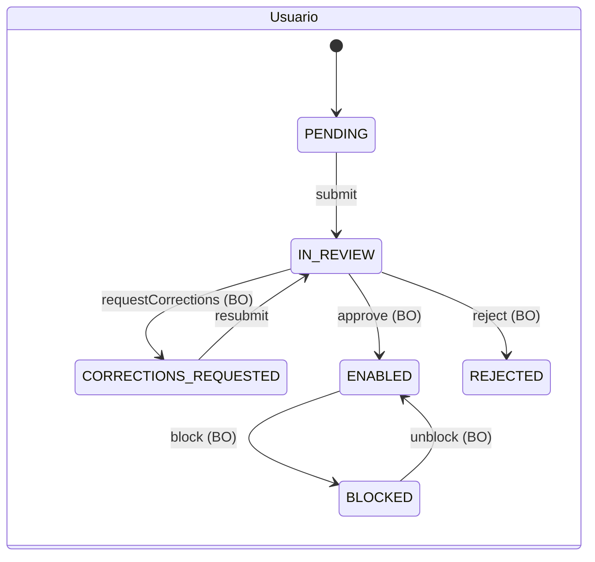
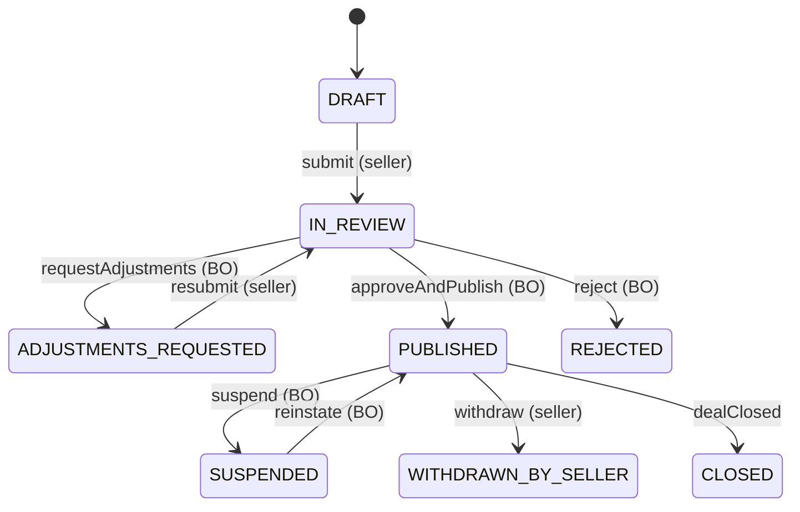
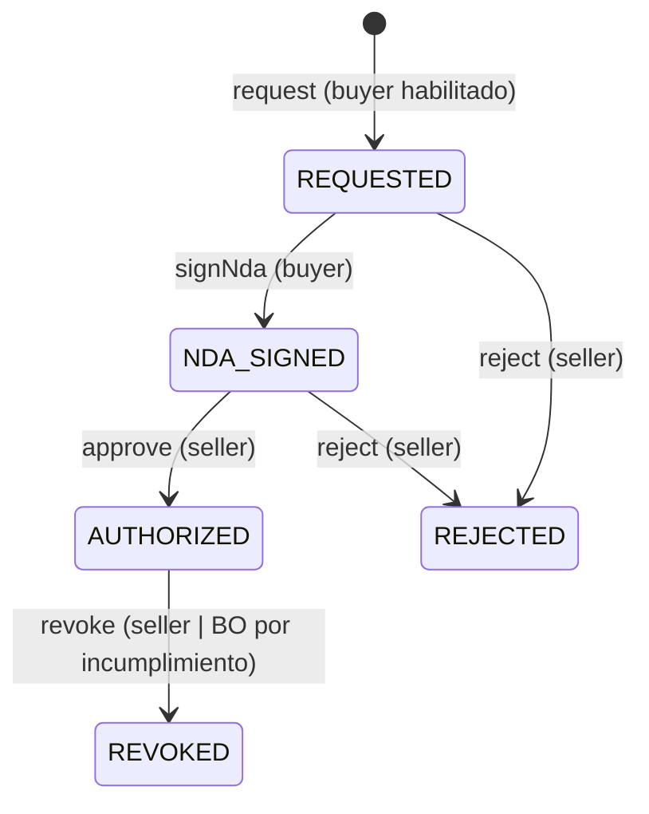
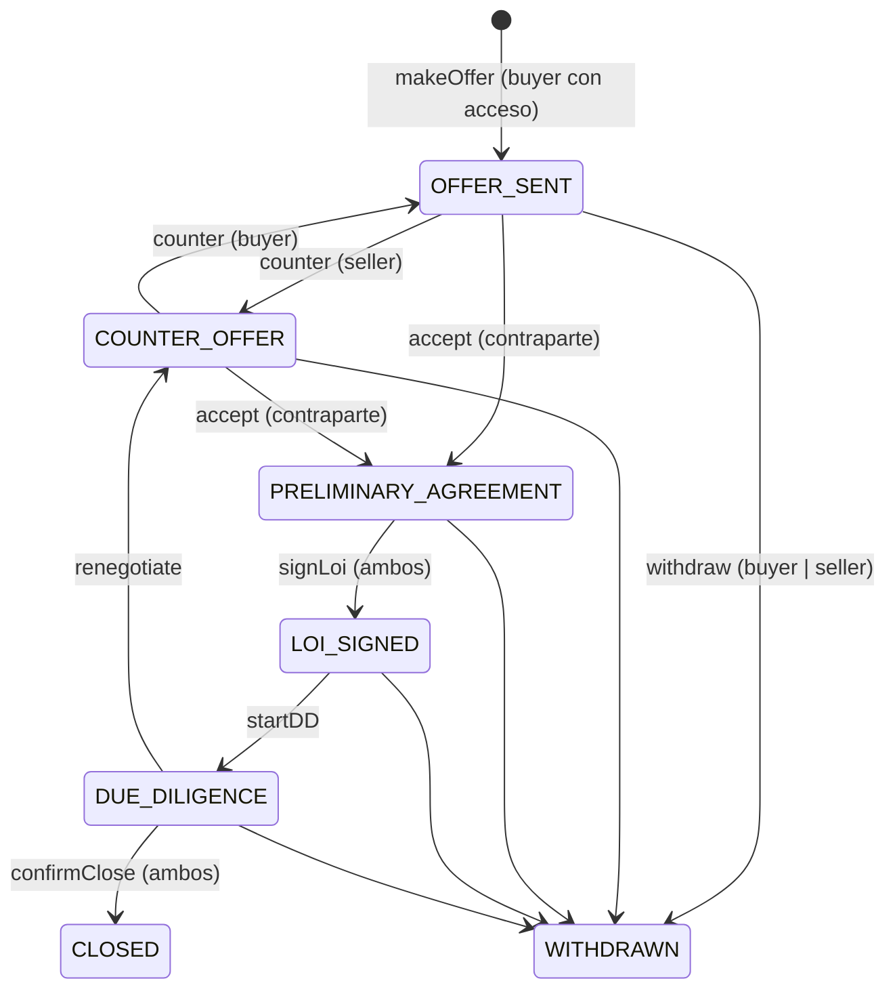

# La Dorada — Especificación de diseño

- **Fecha:** 2026-10-26
- **Estado:** pendiente de revisión
- **Fuentes:** `docs/prompt/prompt-claude-code-la-dorada.md` y `docs/insumos/_md/*` (gana "Sistema general" ante contradicciones)

## 1. Objetivo y criterio de éxito

Construir **La Dorada — "Empresas con más futuro"**, un marketplace web (responsive, PWA) para comprar, vender e invertir en empresas privadas colombianas. Éxito = con las tres cuentas de demo, después de `pnpm demo:reset`, se recorre sin errores el proceso integral:

`Ingreso → Validación → Preparación de empresa → Aprobación → Búsqueda → Acceso reservado (NDA) → Análisis (Data Room) → Oferta → Acuerdo (LOI) → Cierre o desistimiento`

y cada historia H1–H15 tiene al menos un test E2E en verde.

Interfaz y datos de demo en español de Colombia; moneda COP con formato `COP 12.000 M` (millones, separador de miles `.`). Código, commits y nombres técnicos en inglés.

## 2. Reglas del sistema (se aplican en servidor)

| # | Regla | Dónde se garantiza |
|---|---|---|
| R1 | Ninguna empresa se publica sin revisión del Back Office | `opportunityMachine`: solo `BACKOFFICE` ejecuta `publish`; el marketplace solo lista `PUBLISHED` |
| R2 | Documentos reservados solo con NDA firmado y vigente + autorización del vendedor | `canAccessConfidential` en repos, serializadores y endpoint de descarga (URL firmada de 60 s) |
| R3 | Valoración/score no obligan a comprar o vender | Rango orientativo + aviso `<Disclaimer>` obligatorio en valoración, score y ofertas |
| R4 | El Back Office supervisa, no decide por las partes | `dealMachine` rechaza cualquier transición de oferta/LOI/cierre iniciada por `BACKOFFICE` (test explícito) |
| R5 | El comprador puede desistir en cualquier etapa | Evento `WITHDRAW` válido desde todo estado no terminal; expediente termina `CLOSED` o `WITHDRAWN` |
| R6 | Trazabilidad total | `AuditLog` append-only (trigger SQL bloquea UPDATE/DELETE) con hash encadenado; se escribe en la misma transacción que la mutación |
| R7 | No es asesoría financiera ni ejecuta compras automáticas | Avisos en UI y README |
| R8 | No se mueve dinero real | Las ofertas son registros; no hay pasarela |
| R9 | Un usuario no puede ser comprador y vendedor de la misma oportunidad | Política `isPartyConflict` en solicitud de acceso y ofertas |

## 3. Arquitectura

**Monolito Next.js modular** (decisión del usuario; ADR-001).

- Next.js 15 (App Router) + TypeScript estricto + Tailwind CSS + shadcn/ui; pnpm.
- PostgreSQL 16 + Prisma (migraciones versionadas).
- MinIO (S3-compatible) con bucket privado; descargas solo por URL prefirmada.
- Docker Compose: `app`, `db`, `minio`, `mailpit`.
- Vitest (unidad/integración), Playwright (E2E), GitHub Actions (lint, typecheck, test, build).

### 3.1 Capas

```
src/domain/     Puro (sin I/O). Máquinas de estado, políticas can*(), valoración y score, Money/COP, errores de dominio.
src/server/     I/O. auth/, db/ (Prisma), repos/, services/, storage/, realtime/, audit/, adapters/{kyc,esign,video,mail}/
src/app/        Rutas: (public) landing/teaser público, (auth) login/registro, (buyer), (seller), (backoffice), api/
src/components/ ui/ (shadcn) y ld/ (componentes de marca: OpportunityCard, KpiCard, StatusChip, Stepper, Disclaimer…)
prisma/         schema.prisma, migrations/, seed.ts
e2e/            H01…H15.spec.ts, security/*.spec.ts
docs/           adr/, plan/, arquitectura.md, design-system.md, trazabilidad.md, preguntas-abiertas.md
```

**Flujo de toda mutación** (server action o route handler → service):
1. Sesión y rol (`requireUser(role?)`).
2. Validación de entrada con Zod.
3. Política de dominio (`can*`) → `ForbiddenError` (403) si falla.
4. Transición de la máquina de estado → `InvalidTransitionError` (409) si no aplica.
5. Escritura + `AuditLog` en una sola transacción Prisma.
6. Notificación (tabla `Notification` + `pg_notify` para tiempo real + correo mock).

Los componentes de servidor solo leen a través de repos que ya aplican R2; nunca se pasa a cliente un objeto Prisma crudo, sino DTOs serializados por rol.

### 3.2 Autenticación y autorización (ADR-002)

- Sesiones propias en tabla `Session` (token aleatorio de 32 bytes, guardado como hash SHA-256; cookie `httpOnly`, `SameSite=Lax`, `Secure` en prod; expiración 7 días deslizante).
- Contraseñas Argon2id (`@node-rs/argon2`). 2FA TOTP opcional (`otplib`).
- Rate limiting en memoria (token bucket por IP + email) para login, registro y subida de archivos.
- RBAC: `BUYER | SELLER | BACKOFFICE`. ABAC por oportunidad: vendedor dueño, comprador con acceso, Back Office supervisor.
- Un usuario no `ENABLED` solo puede ver su asistente de registro.

### 3.3 Integraciones simuladas (ADR-003)

Cada una es una interfaz en `src/server/adapters/<x>/index.ts` con implementación `mock` seleccionada por variable de entorno.

| Integración | Mock | Para producción |
|---|---|---|
| KYC/AML | Checklist manual del Back Office (identidad, representación legal, listas restrictivas "consultadas") | Proveedor KYC (p. ej. Truora/Metamap) |
| Firma electrónica NDA/LOI | Sello de tiempo + SHA-256 del PDF + IP + user agent | Proveedor de firma (p. ej. DocuSign/Certicámara) |
| Videollamada | Enlace `https://meet.jit.si/ladorada-<uuid>` | Jitsi propio / Google Meet API |
| Correo | Mailpit (SMTP local, UI en :8025) | SMTP/SES |

### 3.4 Tiempo real (ADR-004)

Endpoint SSE `/api/stream` por usuario; el servidor escucha `LISTEN ladorada_events` en Postgres y reenvía eventos dirigidos al usuario. El cliente cae a polling cada 15 s si SSE falla.

## 4. Modelo de datos (núcleo)

| Entidad | Campos clave |
|---|---|
| `User` | email, passwordHash, role, status (máquina usuario), totpSecret?, consentAt (Habeas Data) |
| `Organization` | name, nit, kind (`COMPANY`/`BUYER_ENTITY`), buyerType (fondo, estratégico, family office, ángel) |
| `BuyerPreferences` | sectores, regiones, rango de ingresos/ticket, tipos de oportunidad |
| `VerificationCase` | userId, step (1–6), status, notes; `VerificationDocument` (tipo: cédula, cámara de comercio, RUT, poder), `KycChecklistItem` |
| `Company` | organizationId, sector, subsector, tags, foundedYear, employeesRange, department, city, description, channels, capacity |
| `CompanyFinancialYear` | year, revenue, ebitda, netIncome (COP, `BigInt` en pesos) |
| `Opportunity` | companyId, type, objective, dealSizeRange, horizon, idealBuyerProfile, status, teaserImage, teaserVideo?, publishedAt |
| `InfoSectionVisibility` | opportunityId, section (resumen, negocio, ingresos, EEFF, contratos, capex, litigios, accionistas, operativa, proyecciones), inTeaser, inDataRoom |
| `DataRoomFolder` / `Document` | folder (Estados financieros, Tributario, Contratos, Clientes, Proveedores, Capex, Litigios, Permisos), storageKey, mime, size, confidential, reviewStatus |
| `Evaluation` / `EvaluationItem` | valuationLow/High, score, infoQuality (entregados/requeridos), items: documental, consistencia financiera, dependencia de clientes, contingencias legales con estado `COMPLETED/APPROVED/MEDIUM_RISK/TO_CLARIFY` |
| `Favorite` | buyerId, opportunityId |
| `AccessRequest` | buyerId, opportunityId, purpose, relevance (0–100), status (máquina acceso) |
| `NdaSignature` | accessRequestId, documentHash, signedAt, expiresAt, ip, userAgent |
| `Deal` | opportunityId, buyerId, status (máquina negociación), stage para el stepper |
| `Offer` | dealId, parentOfferId?, author (BUYER/SELLER), preMoneyValue, stakePct, investmentType, paymentScheme, exclusivityDays, validUntil, status |
| `Loi` | dealId, offerId, documentHash, signedByBuyerAt, signedBySellerAt |
| `DealChecklistItem` / `Milestone` | dealId, label, done, dueDate |
| `Question` / `Answer` | dealId u opportunityId, folder, priority, status |
| `Thread` / `Message` / `Meeting` | por oportunidad/deal; adjuntos → `Document`; meeting con link Jitsi |
| `Notification` / `Task` / `Incident` | userId, kind, payload, readAt; tareas con prioridad Alta/Media/Baja; incidencias del Back Office |
| `AuditLog` | id, at, actorId, action, entity, entityId, before/after JSON, ip, prevHash, hash |
| `Setting` | múltiplos por sector, pesos del score, vigencia NDA (días), plazos SLA |

## 5. Máquinas de estado






NDA vencido ⇒ el acceso efectivo se trata como bloqueado aunque el estado sea `AUTHORIZED` (se muestra "Vencido / Bloqueado" en H13).


Todas las transiciones del deal rechazan actor `BACKOFFICE` (R4). El stepper de UI (Contacto → NDA firmado → Oferta → Negociación → LOI → Due Diligence → Cierre) se deriva del estado de acceso + deal.

## 6. Compuerta de confidencialidad (R2)

```ts
canAccessConfidential(user, opp, access, nda, now) =
  user.status === 'ENABLED' && user.role === 'BUYER'
  && opp.sellerId !== user.id
  && access?.status === 'AUTHORIZED'
  && nda?.signedAt != null && nda.expiresAt > now
```
- El vendedor dueño y el Back Office (rol supervisor, solo lectura de metadatos y auditoría) tienen su propia política `canManageDataRoom` / `canSuperviseDataRoom`.
- Aplicación: (a) repos de documentos filtran por la política; (b) serializador de teaser omite toda sección con `inTeaser=false`; (c) `GET /api/documents/:id/download` re-evalúa la política, registra `DOCUMENT_DOWNLOADED` (o `ACCESS_DENIED`) en `AuditLog` y responde 302 a una URL prefirmada de 60 s; (d) el bucket MinIO no tiene política pública.
- Test de aceptación: comprador sin NDA o sin autorización recibe 403 en el endpoint, la URL directa a MinIO sin firma devuelve 403, y queda registro en auditoría.

## 7. Valoración y score (R3; ADR-005)

Función pura `src/domain/valuation.ts`, documentada en `docs/arquitectura.md`.

**Rango de valoración (COP):**
1. Base: último `EBITDA × [mLow, mHigh]` del sector (tabla `Setting`). Si EBITDA ≤ 0, `ingresos × [rLow, rHigh]`.
2. Ajuste por crecimiento (CAGR 3 años): > 15 % → ×1,10; < 0 % → ×0,90.
3. Redondeo a COP 100 M.

Múltiplos iniciales (parametrizables, ilustrativos): agroindustria 5–7×, alimentos y bebidas 6–9×, logística 5–7,5×, servicios financieros/fintech 8–12× (ingresos 2–4× si EBITDA ≤ 0), manufactura 4,5–6,5×, tecnología 8–14×, salud 7–10×, retail 5–8×, construcción 4–6×, energía 6–9×.

**Score 0–100** (pesos parametrizables):
| Componente | Peso | Cálculo |
|---|---|---|
| Calidad de información | 30 % | documentos entregados / requeridos |
| Consistencia financiera | 25 % | estado del ítem de matriz: Aprobada 100, Por aclarar 50, Riesgo 25 |
| Crecimiento | 15 % | CAGR acotado a [−10 %, 30 %] → [0, 100] |
| Margen EBITDA | 15 % | margen acotado a [0 %, 30 %] → [0, 100] |
| Riesgos | 15 % | promedio de dependencia de clientes y contingencias legales (Bajo 100, Medio 60, Alto 20, Por aclarar 40) |

El Back Office ve el cálculo desglosado; el comprador ve rango, score y aviso "Orientativo…". Nota: el valor del pitch (COP 180.000–320.000 M para ingresos de COP 12.000 M) es incoherente con los múltiplos; se registra en `docs/preguntas-abiertas.md` y manda la fórmula.

## 8. Experiencia y sistema de diseño

Detalle en `docs/design-system.md` (se escribe con la skill `frontend-design`). Base extraída del pitch:

- **Marca:** logo SVG propio (montañas/triángulo dorado-ámbar) + wordmark "La Dorada" navy + lema "EMPRESAS CON MÁS FUTURO". Tarjeta de sidebar "Más empresas fuertes para un mejor Colombia." con franja tricolor sutil.
- **Color:** navy `#0B2A6B` (títulos), primario `#1A5CE6` (botón/acción), dorado `#F2B21B` (acento), fondo `#F5F8FF`, superficie `#FFFFFF`, borde `#E3E9F5`; semánticos éxito `#16A34A`, advertencia `#D97706`, peligro `#DC2626`, info `#2563EB`, cada uno con fondo tenue para chips. Modo oscuro opcional vía tokens.
- **Tipografía:** Plus Jakarta Sans (títulos) + Inter (texto, cifras tabulares).
- **Layout:** sidebar con íconos + topbar (búsqueda global, selector de región, ayuda, avatar con rol). Móvil: header con hamburguesa y navegación inferior.
- **Navegación comprador:** Marketplace · Oportunidades guardadas · Mis procesos · Due Diligence · Ofertas · Alertas.
- **Navegación vendedor:** Inicio · Mi empresa · Mis oportunidades · Solicitudes de acceso · Data room · Mensajes · Reuniones.
- **Navegación Back Office:** Inicio · Usuarios · Empresas · Oportunidades · Confidencialidad · Transacciones · Reportes · Configuración · Auditoría.
- **Componentes clave:** OpportunityCard (imagen, chip de tipo, 4 métricas, "Ver teaser"), KpiCard con variación, StatusChip, Stepper horizontal/vertical, VisibilityToggleTable, EvaluationMatrix, OfferCard, ChecklistCard, MilestoneList, ChatThread, MeetingCard, NotificationList, DataTable con filtros, EmptyState, ErrorState, Skeleton, Disclaimer.
- **Microcopy:** explica en cada punto qué es público y qué es confidencial; registro en pasos cortos con progreso visible, "qué falta y por qué" y tiempo estimado ("1 a 2 días hábiles").
- **Calidad:** WCAG 2.2 AA, foco visible, contraste ≥ 4,5:1, Lighthouse ≥ 90 en pantallas clave.

## 9. Pantallas por historia

| H | Rol | Pantalla(s) |
|---|---|---|
| H1 | Comprador | `/marketplace` (KPIs, filtros sector/región/ingresos/EBITDA/tipo, orden, tarjetas), `/opportunities/[id]` teaser, `/saved`, comparación lado a lado (hasta 3) |
| H2 | Comprador | `/processes/[dealId]/due-diligence` (tabs Data room · Análisis financiero · Indicadores · Valoración · Q&A · Notas; progreso; preguntas pendientes) |
| H3 | Comprador/Vendedor | `/messages` (hilos por empresa, adjuntos), reuniones (agendar, aceptar, enlace Jitsi) |
| H4 | Comprador/Vendedor | `/processes/[dealId]/offers` (stepper, oferta actual, historial, LOI, checklist, próximos hitos, chat de negociación) |
| H5 | Comprador | `/alerts` (KPIs, empresas en seguimiento, notificaciones, tareas, estado de procesos) |
| H6 | Vendedor/Comprador | `/onboarding` wizard 6 pasos (perfil, identidad, representación, empresa/entidad, soportes, revisión) |
| H7 | Vendedor | `/seller/company` (general, sector, financiera, operativa, ubicación, soportes, imagen teaser; borrador autoguardado; vista previa) |
| H8 | Vendedor | `/seller/opportunity` (modalidad, objetivo, tamaño, horizonte, perfil ideal) |
| H9 | Vendedor | `/seller/visibility` (tabla de secciones con toggles Teaser / Data room + vista previa del teaser) |
| H10 | Vendedor | `/seller/access-requests` (pendientes/aprobados/rechazados, relevancia, ver perfil, aprobar/rechazar) |
| H11 | Back Office | `/bo/users` (tabs todos/compradores/vendedores, documentos n/m, estado, solicitar corrección, aprobar/rechazar, KYC checklist) |
| H12 | Back Office | `/bo/companies/[id]/evaluation` (rango, calidad de información, matriz, score desglosado, solicitar ajustes / rechazar / aprobar y publicar) |
| H13 | Back Office | `/bo/confidentiality` (tabs Acuerdos NDA · Permisos activos · Auditoría; revocar, registrar incumplimiento) |
| H14 | Back Office | `/bo/transactions` (KPIs en proceso/negociación/cierre/cerradas, procesos activos, retrasos por SLA, incidencias) |
| H15 | Back Office | `/bo/reports` (KPIs, publicadas por mes, cierres acumulados, export CSV y PDF) |

## 10. Datos de demo

- Cuentas: `comprador@demo.ladorada.co`, `vendedor@demo.ladorada.co`, `admin@demo.ladorada.co` (contraseña documentada en README), más ~10 usuarios ficticios en distintos estados.
- 15 empresas ficticias (nombres inventados, NIT ficticios con prefijo 900.000) en agroindustria, alimentos y bebidas, logística, fintech, manufactura, tecnología, salud, retail, construcción y energía, en Antioquia, Valle del Cauca, Bogotá, Atlántico, Santander, Risaralda, etc.; mezcla de estados (borrador, en revisión, publicada, suspendida) y 4 tipos de oportunidad. Imágenes de teaser generadas localmente (ilustraciones SVG por sector) para no depender de terceros.
- Procesos sembrados en distintas etapas para que H5, H13, H14 y H15 muestren datos.
- `pnpm demo:reset` = drop + migrate + seed + carga de archivos de ejemplo a MinIO.

## 11. Pruebas

- **Unidad (Vitest):** máquinas de estado (todas las transiciones válidas e inválidas), políticas, valoración/score, formato COP. Cobertura ≥ 80 % en `src/domain` y `src/server/services`.
- **Integración (Vitest + Postgres de prueba):** services con AuditLog, trigger append-only, compuerta R2 en repos y endpoint.
- **E2E (Playwright):** `e2e/H01…H15.spec.ts` + `e2e/security/confidential-gate.spec.ts`, `e2e/security/backoffice-cannot-decide.spec.ts`, `e2e/demo-journey.spec.ts` (recorrido completo).
- CI ejecuta lint, typecheck, unit, build; E2E con servicios de Docker.

## 12. Entrega por milestones

M0 Descubrimiento → M1 Fundaciones → M2 Alta y validación (H6, H11) → M3 Empresa y publicación (H7–H9, H12) → M4 Hilo delgado (H1, H10, H13, H2, H4 mínimos; recorrido completo demostrable) → M5 Profundización (H1–H5, H13–H15 completos) → M6 Endurecimiento y demo. Cada milestone: plan propio en `docs/plan/`, worktree propio, TDD, verificación ejecutada y code review.

## 13. Fuera de alcance

Pagos o custodia de dinero, integraciones reales de KYC/firma/video, asesoría financiera, app nativa, multi-idioma, multi-moneda.

## 14. Riesgos

- Repo dentro de OneDrive: artefactos ignorados; si la sincronización degrada el rendimiento se propone pausarla o mover el repo.
- Docker Desktop requerido para db, MinIO y E2E.
